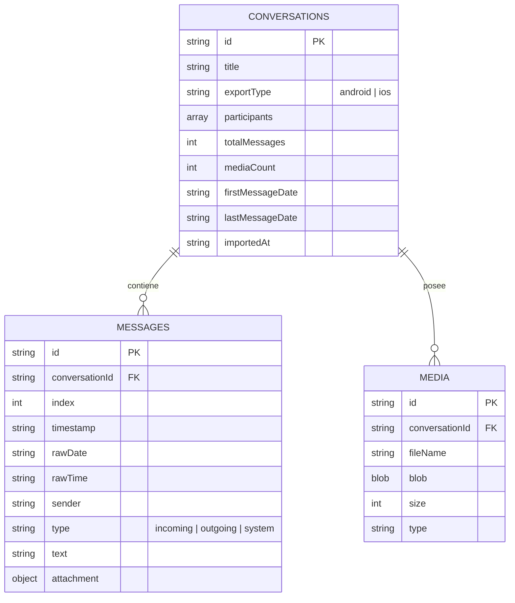

# ChatArchive — Archivo Privado y Visualizador Local de WhatsApp

**ChatArchive** es una aplicación web progresiva (PWA) de alto rendimiento, diseñada para importar, organizar, visualizar, buscar y preservar conversaciones exportadas de WhatsApp en un entorno **100% privado, local y sin conexión**.

---

## 🛡️ Pilares del Proyecto y Privacidad Absoluta

1. **Cero Servidores y Cero Telemetría**: ChatArchive no tiene backend remoto (sin PHP, Node de servidor, Firebase, Supabase, MySQL ni APIs externas). Todas las conversaciones y archivos multimedia residen únicamente en el dispositivo del usuario.
2. **Almacenamiento Local en IndexedDB**: La base de datos cliente `ChatArchiveDB` almacena conversaciones, mensajes indexados cronológicamente y archivos multimedia como objetos binarios (`Blob`) en el navegador.
3. **PWA Instalable y Funcionamiento 100% Offline**: Equipada con un Service Worker (`sw.js`) con estrategia *Cache-First* y un manifiesto `manifest.json` que permite instalar la aplicación en el escritorio (Windows, Mac, Linux) o pantalla de inicio (Android) y utilizarla completamente sin internet.
4. **Despliegue Nativo en GitHub Pages**: Rutas puramente relativas (`./`), sin dependencias de compilación ni servidores intermedios.
5. **Diseño y Estética UI/UX de Alta Fidelidad**: Recreación fiel de la interfaz de chat de WhatsApp con modo claro y oscuro, burbujas entrantes/salientes, mensajes de sistema, reproductor de audio, previsualización de video, visor lightbox de imágenes y personalizador de fondos.
6. **Iconografía Oficial Estricta**: Uso exclusivo de la suite vectorial **Bootstrap Icons** local (`bi-*`), cumpliendo el estándar de no utilizar emojis como iconos de interfaz o botones de acción.

---

## 📂 Arquitectura y Estructura del Código

```text
ChatArchive/
├── index.html                   # Documento principal y contenedor de vistas
├── manifest.json                # Manifiesto PWA para instalación standalone
├── sw.js                        # Service Worker para precaché y modo 100% offline
├── README.md                    # Documentación técnica completa
│
├── assets/
│   ├── icons/                   # Iconos de la aplicación (SVG y PNG 192/512)
│   ├── images/                  # Ilustraciones y recursos visuales
│   └── logo/                    # Logotipo vectorial SVG de ChatArchive
│
├── vendor/                      # Dependencias locales independientes (Sin CDN)
│   ├── bootstrap/               # Bootstrap 5.3.3 (CSS y JS Bundle)
│   ├── bootstrap-icons/         # Bootstrap Icons 1.11.3 (CSS y fuentes WOFF2/WOFF)
│   └── jszip/                   # JSZip 3.10.1 para compresión/descompresión local
│
├── css/
│   ├── style.css                # Variables CSS (tokens de color WhatsApp, tipografía)
│   ├── components.css           # Estilos para navbar, tarjetas, dropzone y modales
│   ├── chat.css                 # Burbujas de chat, multimedia, lightbox y fondos
│   └── responsive.css           # Adaptabilidad para móviles (Bottom Nav) y desktop
│
├── js/
│   ├── app.js                   # Inicialización de la aplicación y ciclo de vida PWA
│   │
│   ├── core/                    # Módulos centrales
│   │   ├── config.js            # Parámetros globales y constantes de la app
│   │   ├── state.js             # Gestor reactivo de estado y persistencia de temas
│   │   └── router.js            # Enrutador cliente basado en hash (#dashboard, #chat...)
│   │
│   ├── database/                # Capa de persistencia local IndexedDB
│   │   ├── db.js                # Conexión, esquemas e índices v1
│   │   ├── conversations.js     # Repositorio CRUD con borrado en cascada
│   │   └── messages.js          # Inserción en lotes y lectura paginada
│   │
│   ├── import/                  # Motor de importación y análisis
│   │   ├── importer.js          # Vista drag & drop y previsualización
│   │   ├── zip-reader.js        # Extractor seguro de archivos ZIP
│   │   ├── txt-reader.js        # Lector y normalizador de texto UTF-8/BOM
│   │   ├── parser.js            # Motor de expresiones regulares multiformato
│   │   └── media-handler.js     # Identificador de tipos MIME y Blobs
│   │
│   ├── views/                   # Controladores de interfaz de usuario
│   │   ├── dashboard.js         # Panel de inicio con métricas de almacenamiento
│   │   ├── library.js           # Lista y cuadrícula de chats con filtros y búsqueda
│   │   ├── chat-viewer.js       # Visor infinito con burbujas, multimedia y estilos
│   │   ├── search.js            # Controlador de búsqueda interna y navegación
│   │   └── settings.js          # Ajustes, temas y centro de respaldos
│   │
│   ├── backup/                  # Motor de exportación y restauración
│   │   ├── export.js            # Generador de respaldos ZIP y JSON
│   │   └── restore.js           # Validador y restaurador en modos fusión/reemplazo
│   │
│   └── utils/                   # Utilidades generales
│       ├── helpers.js           # Formateo de bytes, escape HTML y toasts
│       ├── dates.js             # Detección y parseo universal de fechas WhatsApp
│       └── validation.js        # Sanitización de rutas y prevención de Zip Slip
│
└── workers/                     # Procesamiento multihilo en segundo plano
    ├── parser-worker.js         # Parseo de archivos de texto masivos (100k+ líneas)
    └── search-worker.js         # Búsqueda diacrítica insensible en segundo plano
```

---

## 🛠️ Resumen de Etapas de Desarrollo

### Etapa 1 — Fundación y Diseño
- Arquitectura modular limpia en Vanilla JavaScript ES6+.
- Integración local de **Bootstrap 5.3.3**, **Bootstrap Icons 1.11.3** y fuentes WOFF2/WOFF locales.
- Identidad visual completa con logotipo SVG y favicon en alta resolución.
- Sistema de temas (Claro, Oscuro y Automático según el sistema operativo).
- Barra de navegación superior para pantallas grandes y barra inferior táctil (*Bottom Navigation*) para teléfonos móviles.
- Enrutador hash cliente (`#dashboard`, `#library`, `#import`, `#settings`, `#chat`).

### Etapa 2 — Importación y Parser Inteligente
- Compatible con exportaciones de WhatsApp de **Android** (formato con guion `DD/MM/YYYY, HH:MM - Remitente: Mensaje`) e **iOS** (formato entre corchetes `[DD/MM/YY, HH:MM:SS] Remitente: Mensaje`).
- Soporte para formatos horarios de 12 horas (con sufijos `a. m.`, `p. m.`, `AM`, `PM`) y 24 horas.
- Eliminación automática de marcas de dirección Unicode invisibles (`\u200e`, `\u200f`, `\u202a-\u202e`) y espacios de no separación (`\u202f`, `\xa0`).
- Soporte para mensajes multilínea, adjuntos multimedia y eventos de sistema (cambio de icono, creación de grupo, llamadas perdidas, cifrado de extremo a extremo).
- Procesamiento en segundo plano mediante `parser-worker.js` con barra de progreso reactiva.
- Protección estricta contra ataques de descompresión (*Zip Slip*).

### Etapa 3 — Base de Datos Local (IndexedDB)
- Base de datos local transaccional `ChatArchiveDB` (versión 1).
- **Almacén `conversations`**: Clave primaria `id`, con índices por `title`, `importedAt`, `lastMessageDate`.
- **Almacén `messages`**: Clave primaria `id`, con índices compuestos por `[conversationId+index]` y `[conversationId+timestamp]`. Inserción optimizada en lotes de 1.000 registros por transacción.
- **Almacén `media`**: Clave primaria `id`, almacena Blobs binarios de imágenes, audios y documentos vinculados a sus mensajes.
- Borrado en cascada integral que elimina automáticamente mensajes y multimedia asociados sin dejar huérfanos.

### Etapa 4 — Visor de Conversaciones
- Recreación visual del estilo de chat de WhatsApp con burbujas entrantes, salientes y mensajes centrados de sistema.
- Carga progresiva infinita (lotes de 50 mensajes) al desplazarse hacia arriba o abajo para garantizar 60 FPS incluso con más de 50.000 mensajes.
- Separadores cronológicos inteligentes por fecha ("Hoy", "Ayer" o fecha formateada).
- Reproductor de audio HTML5 nativo integrado para notas de voz.
- Reproductor de video y visor de imágenes con modal **Lightbox** a pantalla completa.
- Descarga directa de documentos adjuntos (`.pdf`, `.docx`, etc.).
- Personalizador visual *Offcanvas*: cambio de densidad de texto (compacta, normal, amplia), estilos de burbuja y temas de fondo (WhatsApp Default, Menta Suave, Doodle Clásico, Pergamino).
- Botones flotantes de desplazamiento rápido para saltar al inicio o al final del chat.

### Etapa 5 — Buscador Avanzado y Navegación
- Motor de búsqueda en segundo plano con `search-worker.js`.
- Búsqueda **insensible a mayúsculas/minúsculas y diacríticos** (normalización Unicode NFD que ignora tildes: buscar "arbol" encuentra "árbol").
- Barra de búsqueda superior desplegable con atajos de teclado:
  - `Enter`: Siguiente coincidencia.
  - `Shift + Enter`: Coincidencia anterior.
  - `Escape`: Cerrar buscador.
- Contador interactivo en vivo (`1 de 45`).
- Panel lateral *Offcanvas* con la lista completa de fragmentos encontrados para saltar a cualquier coincidencia con un solo clic.
- Carga de contexto remoto: si el mensaje buscado está fuera del visor actual, la base de datos carga los mensajes circundantes y enfoca el elemento con una animación pulsante en verde esmeralda (`.ca-message-highlight`).

### Etapa 6 — Respaldos y Restauración (ZIP y JSON)
- **Exportación a ZIP Completo**: Empaqueta conversaciones, mensajes y todos los Blobs multimedia almacenados en un archivo comprimido de respaldo.
- **Exportación a JSON Ligero**: Copia estructurada en texto plano con conversaciones y mensajes para archivado ultrarrápido.
- **Restauración con Control de Conflictos**:
  - **Fusión (`merge`)**: Incorpora las conversaciones del respaldo conservando las existentes.
  - **Reemplazo Total (`replace`)**: Limpia los almacenes antes de restaurar para obtener una copia fiel.
- Inserción en bloques con barra de progreso en tiempo real.

### Etapa 7 — PWA, Rendimiento y Despliegue
- Manifiesto PWA (`manifest.json`) con iconos en formato PNG y SVG (192x192 y 512x512 maskable).
- Service Worker (`sw.js`) con lista de precaché completa de todos los módulos, estilos y fuentes locales.
- Botón de instalación PWA en la interfaz cuando el navegador detecta el evento `beforeinstallprompt`.
- Cero vulnerabilidades XSS mediante sanitización sistemática con `escapeHTML`.
- Revocación automática de `Blob` Object URLs para prevenir fugas de memoria RAM.

---

## 🗄️ Estructura de Datos en IndexedDB



---

## 🚀 Guía de Despliegue en GitHub Pages

Al estar diseñado con rutas relativas (`./`), ChatArchive puede alojarse de forma 100% gratuita en GitHub Pages en menos de 2 minutos:

1. Crea un repositorio en GitHub (por ejemplo, `chatarchive`).
2. Sube los archivos del proyecto a la rama `main` o `gh-pages`:
   ```bash
   git add .
   git commit -m "Despliegue inicial de ChatArchive PWA"
   git push origin main
   ```
3. En el repositorio de GitHub, dirígete a **Settings** > **Pages**.
4. En **Build and deployment** > **Branch**, selecciona `main` (o `gh-pages`) y la carpeta `/ (root)`.
5. Haz clic en **Save**.
6. En pocos segundos, tu aplicación estará disponible en:
   `https://<tu-usuario>.github.io/<tu-repositorio>/`

---

## 📱 Cómo Exportar Chats desde WhatsApp

### En Android:
1. Abre WhatsApp y accede a la conversación que deseas respaldar.
2. Toca los tres puntos verticales en la esquina superior derecha (`⋮`) > **Más** > **Exportar chat**.
3. Selecciona **"Incluir archivos"** (si deseas conservar fotos, audios y documentos) o **"Sin archivos"** (solo texto).
4. Guarda el archivo `.zip` resultante y cárgalo en la pestaña **Importar** de ChatArchive.

### En iOS (iPhone):
1. Abre la conversación en WhatsApp.
2. Toca el nombre del contacto o grupo en la parte superior.
3. Desplázate hacia abajo y pulsa **Exportar chat**.
4. Elige **"Adjuntar archivos"** o **"Sin archivos"**.
5. Comparte o guarda el archivo `.zip` en tu dispositivo y cárgalo en ChatArchive.

---

## 🔒 Compromiso de Privacidad y Licencia

ChatArchive fue desarrollado con la convicción de que los recuerdos, notas de voz y conversaciones privadas pertenecen exclusivamente al usuario. No recopila datos, no usa cookies de seguimiento ni establece conexiones remotas.

Distribuido bajo la **Licencia MIT**. Siéntete libre de utilizarlo, modificarlo y compartirlo.
